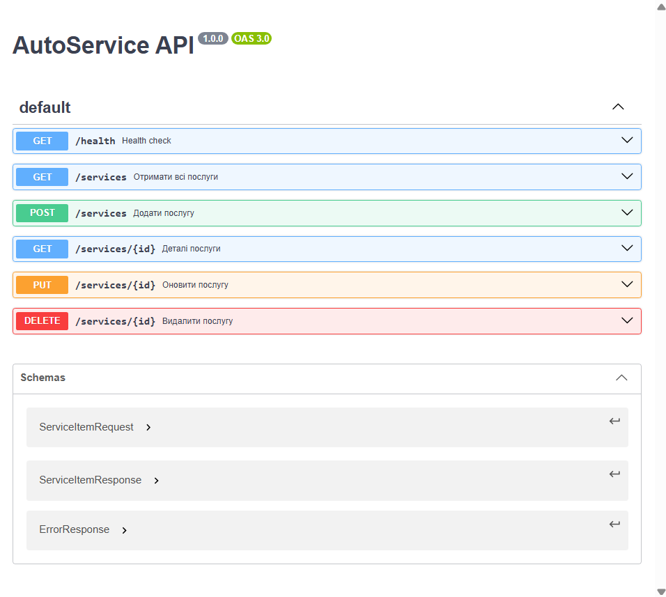

# AutoService Web

## API документація
Контракт API: [openapi.yaml](docs/api/openapi.yaml)


---

# Docker & Docker Compose

## 1. Базова перевірка Docker

Перевірка встановлення та працездатності Docker Engine у системі:

```bash
# Перевірка встановленої версії
docker version

# Тестовий запуск офіційного образу
docker run hello-world

```

---

## 2. Контейнеризація окремого API

Сервіс контейнеризовано за допомогою `.dockerignore` та `Dockerfile` (Multi-stage build).

### Команди збірки та запуску:

```bash
# 1. Збірка Docker-образу API
docker build -t autoservice-api:1.0.0 .

# 2. Запуск контейнера у фоновому режимі (порт 8080)
docker run --name autoservice-app --rm -d -p 8080:8080 autoservice-api:1.0.0

# 3. Перевірка статусу та логів
docker ps
docker logs autoservice-app

# 4. Перевірка доступності ендпоінту Health Check
curl http://localhost:8080/health

# 5. Зупинка контейнера
docker stop autoservice-app

```

**Параметри доступу:**

* **API Endpoint:** `http://localhost:8080`
* **Health Check:** `http://localhost:8080/health`

---

## 3. Оркестрація через Docker Compose

Запуск повного стеку сервісів (Frontend + API + Database) виконується через `docker-compose.yml`.

### Конфігурація сервісів:

* `web`: Nginx-сервер для static-фронтенду з папки `wwwroot` (порт `3000`).
* `api`: .NET Minimal API сервіс (порт `8080`).
* `db`: База даних PostgreSQL 15 Alpine (порт `5432`).

### Команди керування:

```bash
# 1. Запуск усіх сервісів у фоновому режимі
docker compose up -d --build

# 2. Перевірка статусу контейнерів
docker ps

# 3. Перевірка логів
docker logs autoservice-web
docker logs autoservice-api
docker logs autoservice-db

# 4. Перевірка роботи у браузері та терміналі:
# - Веб-інтерфейс: http://localhost:3000
# - Health Check API: curl http://localhost:8080/health

# 5. Повна зупинка та видалення контейнерів
docker compose down

```

**Параметри доступу Docker Compose:**

* **Web Frontend:** `http://localhost:3000`
* **Backend API:** `http://localhost:8080`
* **PostgreSQL Database:** `localhost:5432` (User: `postgres`, DB: `autoservicedb`)

# CI/CD на GitHub Actions


## CI/CD та Delivery (GHCR)

У репозиторії налаштовано повноцінний автоматичний pipeline через GitHub Actions (`.github/workflows/ci-cd.yml`).

### Процес CI (Continuous Integration):
* Автоматичний запуск при `push` та `pull_request` у гілку `main`.
* Встановлення середовища .NET з кешуванням залежностей.
* Компіляція розв'язку та запуск unit-тестів (`dotnet test`).
* Завантаження TRX-артефактів тестування та генерація **Job Summary**.

### Процес CD (Continuous Delivery):
Збірка та публікація Docker-образів двох сервісів у **GitHub Container Registry (GHCR)**:
1. **API Сервіс:** `ghcr.io/<Tutel248>/autoservice-api:latest` (і `sha-<commit>`)
2. **Web Frontend:** `ghcr.io/<Tutel248>/autoservice-web:latest` (і `sha-<commit>`)

---

## Виконані Style Points:
- [x] **Семантичне тегування:** Використання тегів `latest`, `sha-<commit>` та `vX.Y.Z` через `docker/metadata-action`.
- [x] **Job Summary:** Динамічний генератор Markdown-звіту про стан збірки на сторінці виконання Workflow.
- [x] **Dependabot:** Файл конфігурації `.github/dependabot.yml` для автоматичного відстеження оновлень NuGet та Actions.
- [x] **Посилений контроль дозволів та Concurrency:** Явні `permissions` (`packages: write`) та `concurrency` з `cancel-in-progress: true`.
- [x] **Trivy Security Scan:** Перевірка згенерованих Docker-образів на вразливості з параметром `exit-code: 0`.
