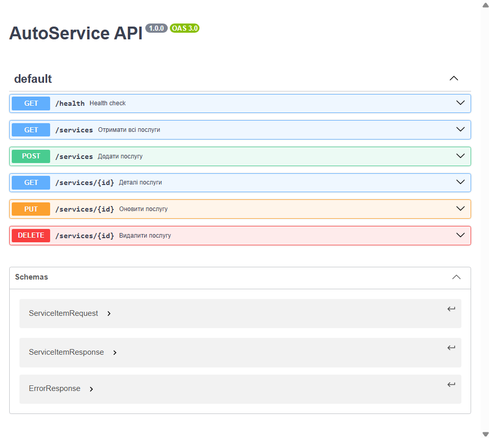
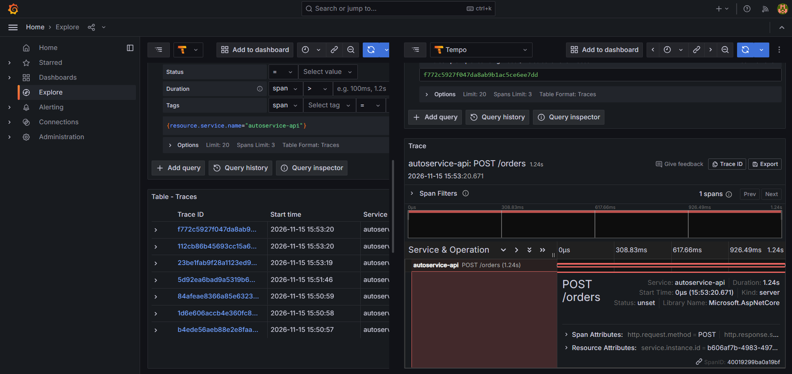
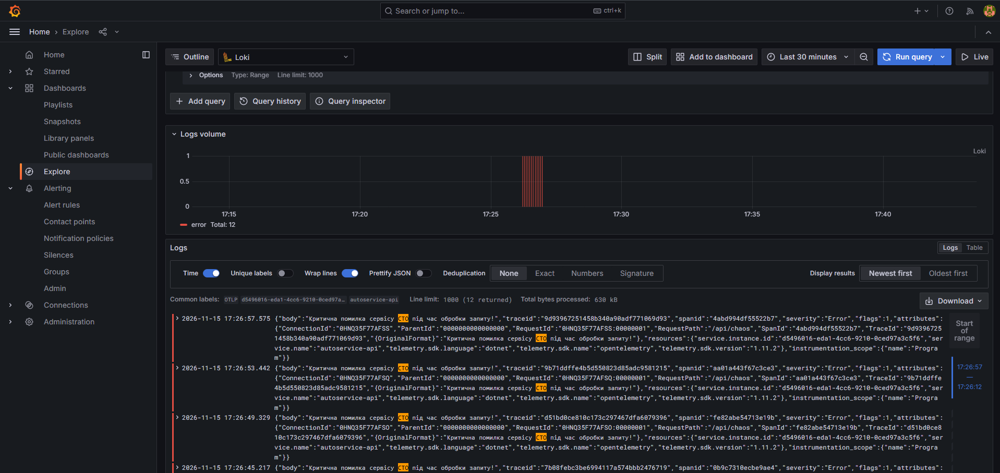

# AutoService Web

## API документація
Контракт API: [openapi.yaml](docs/api/openapi.yaml)


---

# Docker & Docker Compose

## 1. Базова перевірка Docker

Перевірка встановлення та працездатності Docker Engine у системі:

```bash
# Перевірка встановленої версії
docker version

# Тестовий запуск офіційного образу
docker run hello-world

```

---

## 2. Контейнеризація окремого API

Сервіс контейнеризовано за допомогою `.dockerignore` та `Dockerfile` (Multi-stage build).

### Команди збірки та запуску:

```bash
# 1. Збірка Docker-образу API
docker build -t autoservice-api:1.0.0 .

# 2. Запуск контейнера у фоновому режимі (порт 8080)
docker run --name autoservice-app --rm -d -p 8080:8080 autoservice-api:1.0.0

# 3. Перевірка статусу та логів
docker ps
docker logs autoservice-app

# 4. Перевірка доступності ендпоінту Health Check
curl http://localhost:8080/health

# 5. Зупинка контейнера
docker stop autoservice-app

```

**Параметри доступу:**

* **API Endpoint:** `http://localhost:8080`
* **Health Check:** `http://localhost:8080/health`

---

## 3. Оркестрація через Docker Compose

Запуск повного стеку сервісів (Frontend + API + Database) виконується через `docker-compose.yml`.

### Конфігурація сервісів:

* `web`: Nginx-сервер для static-фронтенду з папки `wwwroot` (порт `3000`).
* `api`: .NET Minimal API сервіс (порт `8080`).
* `db`: База даних PostgreSQL 15 Alpine (порт `5432`).

### Команди керування:

```bash
# 1. Запуск усіх сервісів у фоновому режимі
docker compose up -d --build

# 2. Перевірка статусу контейнерів
docker ps

# 3. Перевірка логів
docker logs autoservice-web
docker logs autoservice-api
docker logs autoservice-db

# 4. Перевірка роботи у браузері та терміналі:
# - Веб-інтерфейс: http://localhost:3000
# - Health Check API: curl http://localhost:8080/health

# 5. Повна зупинка та видалення контейнерів
docker compose down

```

**Параметри доступу Docker Compose:**

* **Web Frontend:** `http://localhost:3000`
* **Backend API:** `http://localhost:8080`
* **PostgreSQL Database:** `localhost:5432` (User: `postgres`, DB: `autoservicedb`)

# CI/CD на GitHub Actions


## CI/CD та Delivery (GHCR)

У репозиторії налаштовано повноцінний автоматичний pipeline через GitHub Actions (`.github/workflows/ci-cd.yml`).

### Процес CI (Continuous Integration):
* Автоматичний запуск при `push` та `pull_request` у гілку `main`.
* Встановлення середовища .NET з кешуванням залежностей.
* Компіляція розв'язку та запуск unit-тестів (`dotnet test`).
* Завантаження TRX-артефактів тестування та генерація **Job Summary**.

### Процес CD (Continuous Delivery):
Збірка та публікація Docker-образів двох сервісів у **GitHub Container Registry (GHCR)**:
1. **API Сервіс:** `ghcr.io/<Tutel248>/autoservice-api:latest` (і `sha-<commit>`)
2. **Web Frontend:** `ghcr.io/<Tutel248>/autoservice-web:latest` (і `sha-<commit>`)

---

## Виконані Style Points:
- [x] **Семантичне тегування:** Використання тегів `latest`, `sha-<commit>` та `vX.Y.Z` через `docker/metadata-action`.
- [x] **Job Summary:** Динамічний генератор Markdown-звіту про стан збірки на сторінці виконання Workflow.
- [x] **Dependabot:** Файл конфігурації `.github/dependabot.yml` для автоматичного відстеження оновлень NuGet та Actions.
- [x] **Посилений контроль дозволів та Concurrency:** Явні `permissions` (`packages: write`) та `concurrency` з `cancel-in-progress: true`.
- [x] **Trivy Security Scan:** Перевірка згенерованих Docker-образів на вразливості з параметром `exit-code: 0`.

# Observability та моніторинг (OpenTelemetry + Grafana Stack)

Для забезпечення спостережуваності (Observability) веб-сервісу **AutoService_web** (`service.name = "autoservice-api"`) інтегровано збір трьох сигналів телеметрії (**Traces**, **Metrics**, **Logs**) за стандартом **OpenTelemetry** з передачею даних по протоколу OTLP HTTP (`http://localhost:4318`) до стеку **OTEL Collector - Tempo / Prometheus / Loki - Grafana**.

### 1. Інструментація застосунку

У проєкт додано NuGet-пакети OpenTelemetry (`OpenTelemetry.Extensions.Hosting`, `OpenTelemetry.Instrumentation.AspNetCore`, `OpenTelemetry.Instrumentation.Http`, `OpenTelemetry.Exporter.OpenTelemetryProtocol`) та налаштовано експорт у `Program.cs`:
* **Traces:** автоматичний трейсинг вхідних HTTP-запитів ASP.NET Core, вихідних HTTP-викликів та кастомні бізнес-атрибути спанів (`order.id`, `service.category`, `chaos.fail`, `chaos.delay_ms`) через `System.Diagnostics.Activity`.
* **Metrics:** збір HTTP-метрик тривалості запитів, кількості звернень та розподілу статус-кодів (`http_server_request_duration_seconds_*`).
* **Logs:** структуроване логування через `ILogger` із передачею форматованих повідомлень та прив'язкою до `TraceId` і `SpanId`.
* **Тестовий ендпоінт:** додано маршрут `GET /api/chaos?fail=true&delayMs=1200` для перевірки коректності фіксації 500-х помилок, затримок та спрацювання алертів.

### 2. Перевірка Трейсів (Tempo) та Логів (Loki)

* **Трейси (Tempo):** фіксують повний життєвий цикл HTTP-запиту, час його виконання та вкладені бізнес-атрибути замовлення.  
  

* **Логи (Loki):** зберігають структуровані події застосунку за фільтром `{exporter="OTLP"} |= "СТО"` з можливістю кореляції за `traceid`.  
  

### 3. RED-дашборд у Grafana

Створено дашборд **`AutoService RED Dashboard`** (експортована конфігурація збережена у [`docs/autoservice-red-dashboard.json`](docs/autoservice-red-dashboard.json)), який відображає ключові метрики за методологією RED, потік логів та список активних алертів:

### 4. Налаштування алертів та перевірка статусу Firing
У розділі Grafana Alerting створено точку сповіщення (Contact point: AutoService-Ops) та два правила моніторингу з інтервалом оцінки 1m та періодом очікування Pending: 1m:

* AutoService High 5xx Error Rate — спрацьовує, якщо частка 5xx-помилок перевищує 5% (IS ABOVE 5).

* AutoService High p95 Latency — спрацьовує, якщо 95-й перцентиль затримки відповіді перевищує 0.5 с (IS ABOVE 0.5).

### 6. Контроль кардинальності метрик (Cardinality)

Для запобігання вибуху кардинальності (*cardinality explosion*) у Prometheus використовуються лише мітки з низькою кардинальністю (`http_request_method`, `http_response_status_code`, шаблонізований `http_route`), тоді як висококардинальні ідентифікатори (`order.id`, `requestId`) передаються виключно в атрибути трейсів (Tempo) та тіло логів (Loki).

#### Формули оцінки теоретичної кардинальності

1. **Для звичайної метрики (Counter / Gauge):**
   `C = |L1| * |L2| * ... * |Ln|`
   де `|Li|` — кількість унікальних значень `i`-ї мітки.

2. **Для гістограми (Histogram):**
   `C_hist = (|L1| * |L2| * ... * |Ln|) * (B + 2)`
   де `B` — кількість кошиків затримки (`le`), а `+ 2` — супутні лічильники `_sum` та `_count`.

#### PromQL-запити для перевірки реальної кардинальності

* **Кількість активних серій сервісу `autoservice-api`:**
  ```promql
  count(http_server_request_duration_seconds_count{service_name="autoservice-api"})
  ```

* **Кардинальність конкретної мітки (кількість унікальних статус-кодів):**
  ```promql
  count(count by (http_response_status_code) (http_server_request_duration_seconds_count))
  ```

* **Загальна кількість усіх активних серій у пам'яті Prometheus:**
  ```promql
  prometheus_tsdb_head_series
  ```
